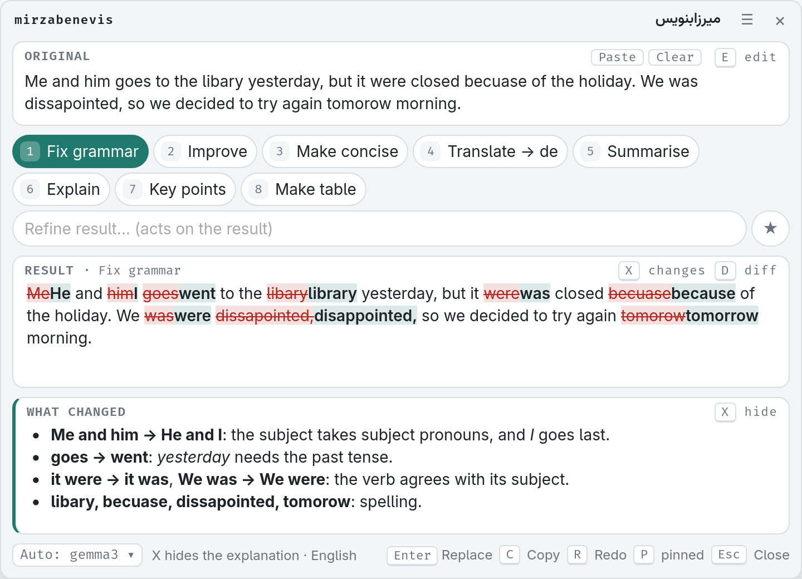
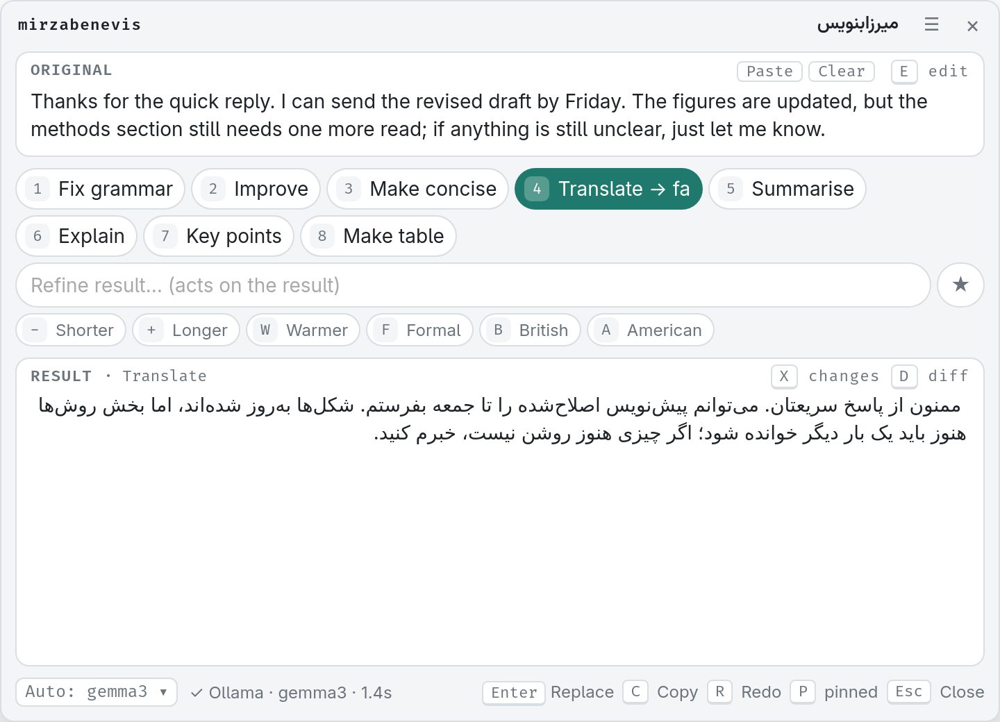
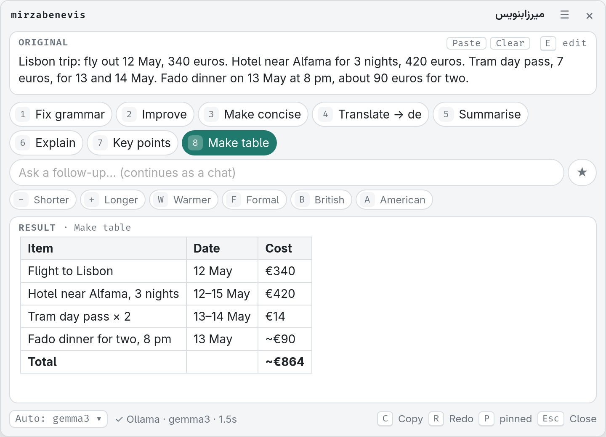
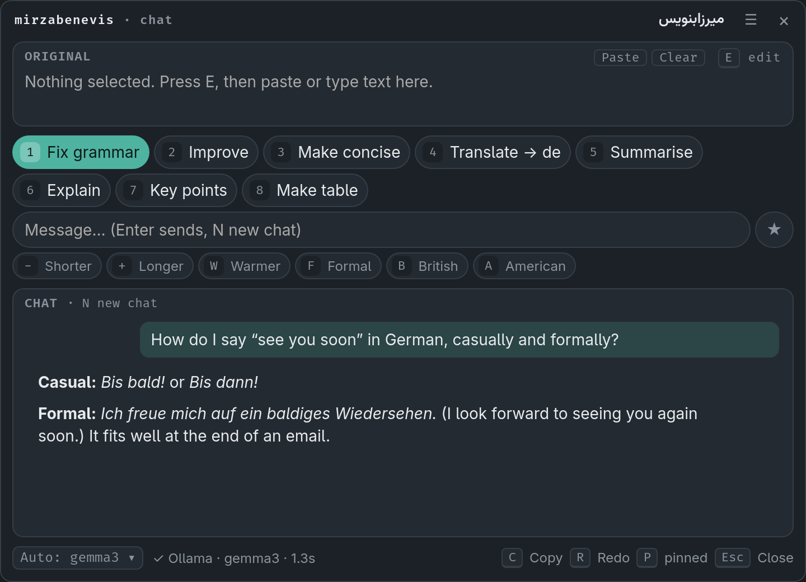
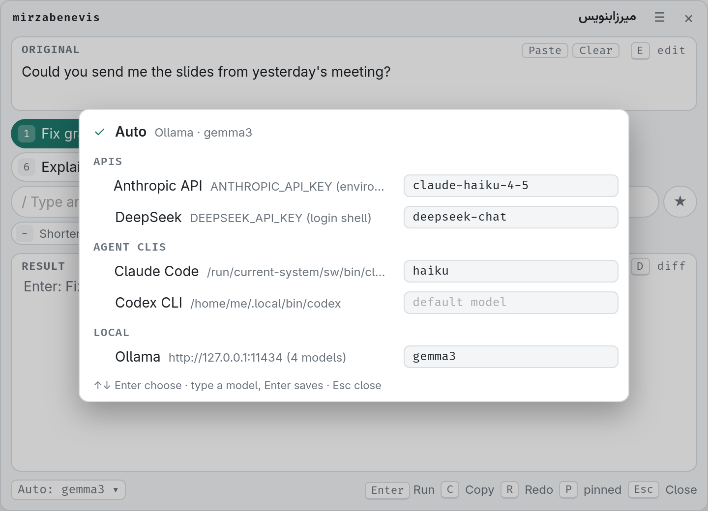

# mirzabenevis

Select text in any app, press a key, and get it back fixed, rewritten or translated, right where it was.

The name is *میرزابنویس* (mirzabenevis), Persian for a scribe: someone who writes for others
(from *mirza*, a learned secretary, and *benevis*, "write!").
It is a small tray app with a popup, plus a headless CLI. Linux first (Wayland and X11),
NixOS friendly, and it finds the AI you already have without any configuration.

> **About this project.** mirzabenevis is fully vibe-coded: all of its code was written
> by AI. It grew out of a daily need of mine, and it is inspired by similar tools such as
> [WritingTools](https://github.com/theJayTea/WritingTools) and the Tauri-based
> [redrafter](https://github.com/Tapnetix/redrafter). I built it as a fun side project.



## Features

- Select text anywhere, press a hotkey, and the result is pasted back over the selection.
- Uses the AI you already have, with no setup: API keys (Anthropic, DeepSeek, OpenAI,
  Gemini, OpenRouter, Groq, Mistral and more), agent CLIs (Claude Code, Codex, `llm`; Gemini
  CLI once you pick it), local servers (Ollama, LM Studio, llama.cpp, vLLM, Jan), or your
  own endpoint or command.
- If a backend fails, it only falls back to another one from the same vendor. Your text is
  never sent to a different company behind your back.
- Built-in actions: Fix grammar, Improve, Make concise, Translate, Summarise, Explain, Key
  points, Make table. Add your own in the config or in the settings window.
- Results stream in, with an inline word diff and a key to ask what changed and why.
- One-shot modifiers: shorter, longer, warmer, formal, British, American.
- Type your own instruction, refine the result, and save it as a new action with ★.
- Chat when nothing is selected. Summaries, explanations, key points and tables are
  rendered as Markdown.
- History of runs, and undo (pastes the original back).
- A settings window (`Ctrl+,`) that edits `config.toml` for you and keeps its comments.
- Persian, Arabic and Hebrew text reads right to left, paragraph by paragraph (`L` forces a
  direction), and the single-key shortcuts work on non-Latin keyboard layouts too.
- `mirzabenevis-cli`: bind an action straight to a key, or pipe text through it.

## Screenshots

| Translate (here into Persian, laid out right to left) | Make table from notes |
| --- | --- |
|  |  |
| **Chat when nothing is selected** (dark theme) | **Backend picker** (`M`): what it found on this machine |
|  |  |

## Install

NixOS, with this repo as a flake input:

```nix
# flake.nix
inputs.mirzabenevis.url = "github:ehsanirani/mirzabenevis";

# configuration.nix (with `inputs` passed in via specialArgs)
environment.systemPackages = [ inputs.mirzabenevis.packages.${pkgs.stdenv.hostPlatform.system}.default pkgs.wl-clipboard ];
programs.ydotool.enable = true;                  # pastes back on GNOME/KDE Wayland
users.users.<you>.extraGroups = [ "ydotool" ];   # log out and in after this
```

Try it without installing: `nix run github:ehsanirani/mirzabenevis -- --popup`.

Other distros: download the `.deb` or AppImage from
[GitHub Releases](https://github.com/ehsanirani/mirzabenevis/releases). The Home Manager
module, building from source and the GNOME tray extension are covered in
[docs/install.md](docs/install.md).

## Quick start

1. Check your desktop:

   ```sh
   mirzabenevis-cli doctor
   ```

   It checks the tools that grab the selection and paste the result, lists the AI backends
   it found, and prints the exact key-binding and autostart lines for your desktop. It
   changes nothing.

2. Bind `mirzabenevis --popup` to a key. On Hyprland, for example:

   ```
   bind = SUPER, G, exec, mirzabenevis --popup
   ```

   On GNOME or KDE, add a custom shortcut with that command (the Home Manager module can
   write the GNOME one, with one line of your own: see [docs/install.md](docs/install.md#home-manager)). The command starts the tray app if it is not running yet.

3. Select some text, press your key, press `1` (Fix grammar), then `Enter` to paste the
   result over the selection.

No config file is needed. `mirzabenevis-cli providers` shows which backends were found, and
`mirzabenevis-cli config use <id>` pins one. If you would rather skip the popup, bind
`mirzabenevis-cli run fix` to a key: it fixes the selection and pastes it back directly.
More in [docs/cli.md](docs/cli.md).

## Popup keys

| Key | Does |
| --- | --- |
| `1`–`9` | Run that action (Fix grammar, Improve, Make concise, Translate, Summarise, ...) |
| `Enter` | Run the active action; with a result, replace the selection |
| `/` | Type an instruction (refines the result; continues as a chat after a summary) |
| `D` / `X` | Toggle the word diff / explain what changed |
| `-` `+` `W` `F` `B` `A` | Toggle a modifier for the next run |
| `T` / `M` | Next translation language / backend picker |
| `C` / `R` / `E` | Copy / redo / edit the original |
| `U` | Undo the last replace |
| `L` | Text direction: auto, right-to-left, left-to-right |
| `P` | Pin / unpin (a pinned popup stays open when focus leaves; on by default) |
| `Ctrl+,` / `☰` | Settings / menu |
| `Esc` | Cancel, or close |

All keys, chat mode and the ★ chips: [docs/popup.md](docs/popup.md).

## Configuration

Everything works with the built-in defaults. `mirzabenevis-cli config init` writes a
commented config to `~/.config/mirzabenevis/config.toml`, and
[`config.example.toml`](config.example.toml) shows every setting. Most of it can also be
changed from the popup's settings window. Backends, actions, modifiers and the rest:
[docs/configuration.md](docs/configuration.md).

## Documentation

- [Install](docs/install.md): NixOS, Home Manager, .deb/AppImage, from source
- [Configuration](docs/configuration.md): backends, fallback, actions, modifiers, every setting
- [CLI and grab/paste](docs/cli.md): `mirzabenevis-cli`, history/undo, keybinds, paste internals
- [Popup](docs/popup.md): full key reference, chat, settings, troubleshooting
- [Security and privacy](docs/security.md): agent-CLI sandboxing, history, clipboard
- [Development](docs/development.md): dev shell, tests, adding a backend or action, releasing
- [Changelog](CHANGELOG.md)

## Status

Early: version 0.1.0. It works on Linux, on Wayland and X11. Which tools
grab and paste on each desktop (GNOME, KDE, Hyprland, Sway, X11) is in
[docs/cli.md](docs/cli.md#grab-and-paste-on-linux).

Windows and macOS are not supported yet. The core is OS-agnostic, but grabbing the
selection and pasting back are Linux-only.

## Contributing

Bug reports and pull requests are welcome.
[docs/development.md](docs/development.md) covers the dev shell, the tests, the pre-commit
hooks, and how to add an action or a backend.

## Acknowledgements

- [WritingTools](https://github.com/theJayTea/WritingTools), for the idea of a system-wide
  select-and-rewrite tool.
- [redrafter](https://github.com/Tapnetix/redrafter), a Tauri app that redrafts selected
  text in place with a hotkey.
- [Tauri](https://tauri.app), which the popup is built on.

## License

MIT, see [LICENSE](LICENSE).
